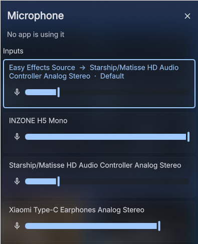
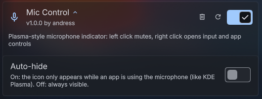

# Mic Control

A microphone indicator and control center for the [DankMaterialShell](https://danklinux.com) DankBar, modeled after the KDE Plasma active-microphone indicator.





## Features

- **Left click** mutes or unmutes the current default input, whatever it is.
- **Right click** opens a popout with:
  - every input device, including virtual ones like the EasyEffects source, each with its own volume slider and mute button; click a card to make it the default input
  - every app currently recording, with per-app volume and mute
- **Scroll** over the icon to change the input volume.
- **Auto-hide**: the icon only shows while an app is using the microphone (can be turned off in the plugin settings).
- The icon turns the theme's primary color while recording and the error color when you are muted during a recording.
- Translated into the 22 languages DMS ships; it follows the DMS locale.

## EasyEffects

The `easyeffects_source` node is a passthrough null sink, so PipeWire ignores its own mute and volume. When it is the default input, Mic Control applies mute and volume to the physical microphone EasyEffects reads from, taken from `~/.config/easyeffects/db/easyeffectsrc`. If EasyEffects is set to follow the default input device, all physical inputs are muted together.

EasyEffects, cava and level meters (like pavucontrol's) are not counted as "using the microphone".

## Installation

### DMS Settings

Open **Settings → Plugins → Browse**, search for **Mic Control** and install it.

### DMS CLI

```bash
dms plugins install micControl
```

### Manual

```bash
git clone https://github.com/MrAndyVF/dms-mic-control ~/.config/DankMaterialShell/plugins/micControl
dms restart
```

Then enable **Mic Control** in **Settings → Plugins** and add it to a section in **Settings → Dank Bar**.

## Settings

| Setting | Description | Default |
|---------|-------------|---------|
| **Auto-hide** | Only show the icon while an app is using the microphone | On |

## Requirements

- DankMaterialShell 1.6.3 or newer
- PipeWire

No extra packages are needed; everything goes through Quickshell's PipeWire service.

## License

[GPL-3.0](LICENSE)
